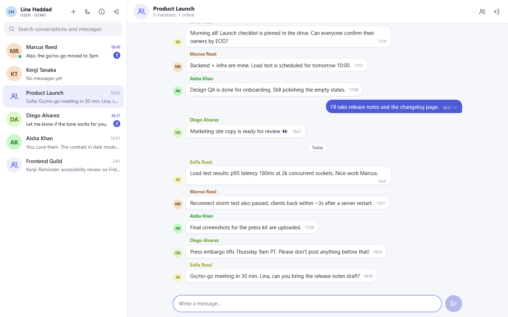
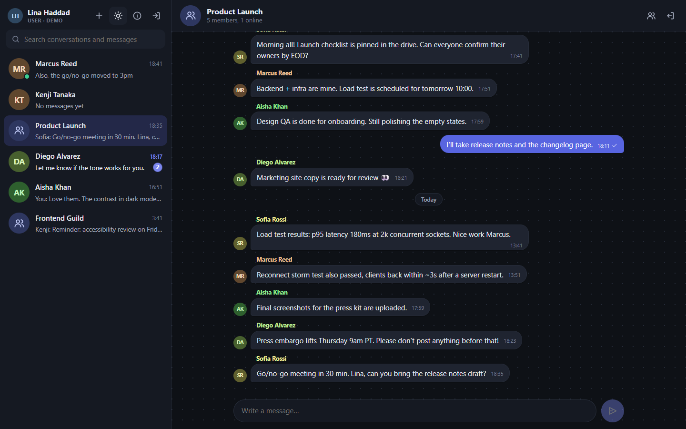
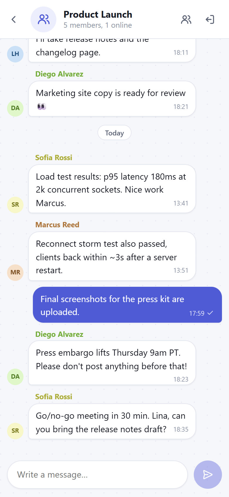
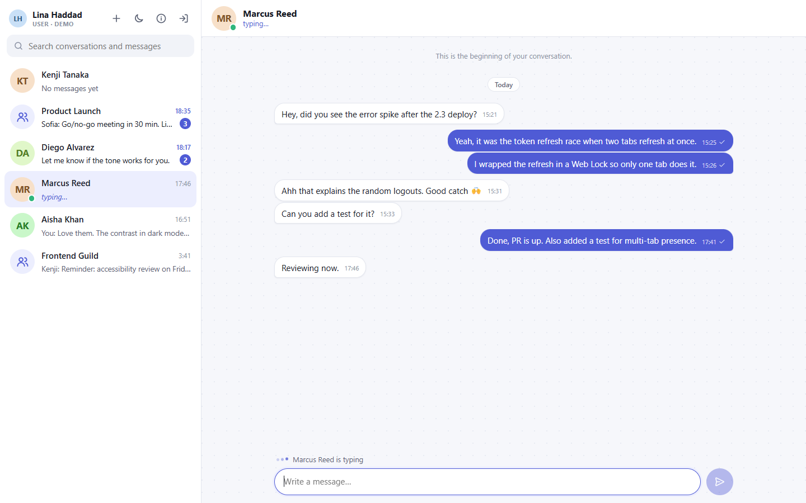

# Relay: real-time chat with Socket.IO

A full-stack messaging app: private and group conversations, instant delivery, typing indicators, read receipts, online presence and unread counts. Built with **TypeScript, Node.js, Express 5, Socket.IO 4, MongoDB (Mongoose) and JWT authentication**, with a framework-free TypeScript client.

The focus is on how a real chat backend behaves: authenticated sockets, server-side authorization for every room, idempotent message delivery, presence that stays correct across tabs, and clients that recover from disconnects and expired tokens on their own.



| Dark theme | Mobile | Typing indicator |
| --- | --- | --- |
|  |  |  |

## Features

- **Real-time messaging** over Socket.IO with acknowledgements, plus optimistic "sending…" bubbles and Retry for messages that didn't go through
- **Direct and group conversations**; starting the same direct chat twice opens the existing one
- **Typing indicators**, **read receipts** ("Seen") and **unread badges**, kept in sync across your own tabs
- **Online / last seen presence** that handles several tabs and devices per user
- **Message history** stored in MongoDB, with "load older" pagination as you scroll up
- **Search** across conversation names and the text of your own messages
- **Sign in / sign up** on the existing JWT system, with silent token refresh and reconnection
- **Responsive UI** for desktop, tablet and mobile, plus a light/dark theme, loading, empty, error and disconnected states
- **Security**: socket handshake auth, membership checks, input validation, rate limits, CSP headers, safe upload handling
- **End-to-end TypeScript (`strict`)**: one shared contract ([shared/types.d.ts](shared/types.d.ts)) types every REST shape and Socket.IO event on both server and client
- **31 automated tests** covering auth, authorization, delivery, presence, dedupe and the REST API

## Why Socket.IO instead of polling?

With REST polling, every client asks "anything new?" every few seconds. Messages arrive up to one interval late, most requests return nothing, and server load grows with the number of open tabs, not with actual activity. Typing indicators and presence change several times a second, so polling handles them badly.

A Socket.IO connection stays open, so the server **pushes** events the moment they happen. Socket.IO also adds what raw WebSockets lack: automatic reconnection with backoff, a long-polling fallback for networks that block WebSockets, rooms for targeted broadcasts, acknowledgements for request/response semantics, and middleware for authenticating the handshake.

REST is still the better tool for some jobs, so the app uses both:

| Concern | Transport | Why |
| --- | --- | --- |
| Login, sign-up, token refresh | REST | Stateless, standard HTTP semantics and status codes |
| Conversation list, message history (paginated), search | REST | Request/response data that suits pagination and is easy to cache and test |
| New messages, typing, presence, read receipts | Socket.IO | Pushed by the server the instant they happen |
| Sending a message | Socket.IO (with ack), or REST | The socket path is the fast path; `POST /conversations/:id/messages` uses the same service and broadcasts too |

## Architecture

```text
 Browser (client/)                              Node.js process (src/)
┌────────────────────────┐   HTTPS /api/*   ┌──────────────────────────────────────────┐
│ api.ts   REST + tokens ├─────────────────►│ Express app.ts                           │
│                        │                  │  routes → validators → controllers       │
│ socket.ts Socket.IO    │   WebSocket      │                  │                       │
│  auth: { token }       ├◄────────────────►│ Socket.IO sockets/index.ts               │
│                        │                  │  middleware.ts (JWT handshake)           │
│ store.ts  state        │                  │  handlers/ connection · conversation ·   │
│ views/    rendering    │                  │            message · typing              │
└────────────────────────┘                  │                  │                       │
                                            │  services/ conversation · message ·      │
                                            │            presence (shared by both)     │
                                            │                  │                       │
                                            │  sockets/emitter.ts ← REST pushes events │
                                            └──────────────────┬───────────────────────┘
                                                               ▼
                                              MongoDB: users · conversations · messages
```

- **Services hold the business rules** (membership checks, validation, persistence). REST controllers and socket handlers are thin adapters around them, so both paths enforce the same rules.
- **`sockets/emitter.ts`** lets REST controllers push events (for example "new group created") without importing the Socket.IO server; it does nothing in scripts and REST-only tests.
- **`app.ts` builds the Express app and `server.ts` starts it**, so tests mount the real app and the real Socket.IO server on a random port against an in-memory MongoDB.
- **One typed contract.** [shared/types.d.ts](shared/types.d.ts) defines the JSON shapes and `ClientToServerEvents` / `ServerToClientEvents`. The server is a typed `Server<…>` and the client a typed `Socket<…>`, so renaming an event or changing a payload breaks the build on both sides. Acknowledgement results are type-checked too: `handle<"message:send">(…)` only accepts a handler that returns what that event's ack promises. Incoming payloads are still treated as `unknown` and validated at runtime, because types don't protect against a hostile client.

### How a message travels

1. The client adds an optimistic bubble and emits `message:send { conversationId, text, clientId }` with an acknowledgement callback (10 s timeout).
2. The handler takes the **sender from `socket.data.user`** (set from the verified JWT) and ignores any sender in the payload.
3. `message.service` rate-limits, cleans and validates the text, **checks membership in MongoDB**, saves the message and updates the conversation's preview.
4. `message:new` goes to every member's `user:<id>` room, so all their tabs and devices get it, including the sender's other tabs.
5. The ack returns the saved message. The client swaps it in for the optimistic bubble, matched by `clientId`.
6. Recipients who have the chat open emit `message:read`; everyone else's unread badge goes up.

The full event list, payloads and error codes are in **[docs/SOCKET_EVENTS.md](docs/SOCKET_EVENTS.md)**.

## Authentication and authorization

- **One identity system for both transports.** The existing JWT access/refresh pair is reused. The access token goes in the Socket.IO handshake (`auth.token`), never in the URL. The server verifies it, **loads the user from the database** (so deleted accounts are refused) and keeps the identity on `socket.data.user`.
- **Expired tokens:** the handshake rejects them with `TOKEN_EXPIRED`. If a token expires while the socket is open, the server emits `auth:expired` and disconnects. The client refreshes through `POST /api/auth/refresh` and reconnects. Tabs share the session; a Web Lock makes only one tab refresh at a time, because the server keeps only the latest refresh token.
- **Logout and account deletion** close all of that user's sockets (`session:ended`).
- **Every private operation checks membership** (`findForMember`): joining a room, sending, marking read, loading history, leaving. Non-members get `404` / `NOT_FOUND`, the same as for an id that doesn't exist, so ids can't be probed.
- **Rooms aren't trusted as access control.** Messages go to the member list read from MongoDB at send time. Conversation rooms only carry typing events, and joining one requires the same membership check.
- **Roles:** user administration (`/api/users` list/create/update/delete) needs `admin` or `manager`, **and** a non-demo account. Everyone else can only see their own profile (`/api/users/me`) and a public contact list that contains no email, phone or documents.

## Message persistence

```text
users          { firstName, lastName, email*, phoneNumber*, password (bcrypt, hidden), role, avatar,
                 refreshToken (hidden), isDemo, lastSeenAt }
conversations  { type: direct|group, name, members: [{ user, joinedAt, lastReadAt }], createdBy,
                 directKey*, lastMessage { text, sender, createdAt }, lastMessageAt }
messages       { conversation, sender, text (≤ 2000), clientId, createdAt }
                                                                     (* = unique index)
```

| Index | Purpose |
| --- | --- |
| `messages { conversation, createdAt: -1, _id: -1 }` | History pages and unread counts, without scanning |
| `messages { sender, clientId }` unique (partial) | A retried send returns the original message instead of a duplicate |
| `conversations { members.user, lastMessageAt: -1 }` | "My conversations, newest first" |
| `conversations { directKey }` unique (partial) | One direct chat per pair, even if both users open it at the same moment |

- **Pagination** uses a `(createdAt, _id)` cursor (`?before=<messageId>`), not `skip`, so pages stay correct while new messages arrive.
- **Unread counts** come from each member's `lastReadAt`: messages from others created after it. No per-message read rows are needed.
- **Sidebar preview** (`lastMessage`) is stored on the conversation, so the list is one query.

## Technical challenges and decisions

- **Presence with several tabs.** Counting "connected" per socket would mark you offline when you close one of two tabs. Presence keeps a set of socket ids per user and broadcasts only on the first connect and the last disconnect.
- **Duplicate messages.** Network retries and lost acks can resend a message. A client-generated `clientId` plus a unique index makes sending idempotent at the database level, and the client merges by id.
- **Expiring tokens on long-lived connections.** HTTP requests can refresh on a 401, but a socket stays authenticated after its token expires. A server-side timer at the token's `exp` closes the gap.
- **Refresh races between tabs.** The existing API rotates refresh tokens, so two tabs refreshing at once would invalidate each other. `navigator.locks` serializes refreshes, and a tab that waited reuses the new token. Building this also exposed a bug in the existing auth: two refresh tokens issued in the same second were identical, so rotation didn't invalidate the old one. Fixed with a random `jti`.
- **Catching up after a disconnect.** Socket.IO doesn't replay missed events by default. On every reconnect the client refetches the conversation list and the newest page of the open chat, then merges by id.
- **No framework on the client.** The UI is TypeScript compiled by `tsc` straight to ES modules (no bundler), with a small state store and render functions. User text is only ever written with `textContent`, and a strict Content-Security-Policy (`script-src 'self'`) blocks inline scripts.
- **TypeScript without a server build step.** Node 22.18+ runs `.ts` files directly by stripping the types, so `npm start` runs `src/server.ts` as-is and `tsc` only type-checks (`npm run typecheck`). `erasableSyntaxOnly` keeps the code to syntax that can be stripped (no `enum`s or namespaces). Only the browser client is compiled, because browsers can't run TypeScript.

## Project structure

```text
src/
├── app.ts                 Express app (routes, static client, error handling)
├── server.ts              Env, MongoDB, HTTP server + Socket.IO, graceful shutdown
├── config/                env loading, MongoDB connection, CORS
├── models/                User, Conversation, Message (schemas + indexes)
├── services/              Business rules shared by REST and sockets
├── controllers/           REST handlers (thin)
├── routes/                /api/auth, /api/users, /api/conversations, /api/messages
├── validators/            express-validator schemas
├── middleware/            verifyToken, allowedTo, denyDemo, rateLimit, upload, errors, headers
├── sockets/
│   ├── index.ts           Creates the typed Socket.IO server
│   ├── middleware.ts      JWT handshake authentication
│   ├── emitter.ts         Rooms + emitting from anywhere
│   ├── handle.ts          Payload checks, typed acks and error mapping for every event
│   ├── types.ts           AppServer / AppSocket / SocketData types
│   └── handlers/          connection (presence, token expiry), conversation, message, typing
├── types/                 Express Request augmentation (req.user)
└── utils/                 AppError, tokens, rate limiter, sanitizing
shared/types.d.ts          The REST + Socket.IO contract, used by server and client
client/
├── src/                   TypeScript: api, socket, store, views/ (compiled to client/js/)
├── index.html, css/, assets/
└── tsconfig.json          Browser build settings
scripts/                   seedDemo.ts, createManager.ts
tests/                     node:test + socket.io-client + in-memory MongoDB
docs/                      SOCKET_EVENTS.md, DEMO_CREDENTIALS.md, screenshots/
postman/                   Postman collection + environment for the REST API
uploads/                   Avatars / documents (user uploads are git-ignored)
```

## Running locally

**Requirements:** Node.js 22.18+ (developed on 24; it runs the `.ts` files directly) and a MongoDB database (Atlas free tier or local).

```bash
npm install
cp .env.example .env          # then fill in MONGODB_URI and two long random JWT secrets
npm run seed                  # demo users + conversations (safe to re-run)
npm run dev                   # builds the client, then serves http://localhost:3000
```

Open http://localhost:3000 and sign in with a demo account ([docs/DEMO_CREDENTIALS.md](docs/DEMO_CREDENTIALS.md)). Use a second browser or a private window to sign in as another user and chat in real time.

The Express server serves the client too, so there is nothing else to start.

| Script | What it does |
| --- | --- |
| `npm run dev` | Build the client, then start the server with auto-restart on file changes |
| `npm run dev:client` | Rebuild the client on every save (run next to `npm run dev`, then refresh the browser) |
| `npm run build` | Compile `client/src` to `client/js` |
| `npm start` | Start for production (run `npm run build` first) |
| `npm run typecheck` | Type-check server, scripts, tests and client (`strict`) |
| `npm test` | Run the test suite (downloads a MongoDB binary on first run; never touches your `.env` database) |
| `npm run seed` | Create the demo data; `npm run seed -- --reset` refreshes the demo messages |
| `npm run create-manager -- --email … --password …` | Create or promote a real manager account |

### Environment variables

| Variable | Required | Description |
| --- | --- | --- |
| `MONGODB_URI` | yes | MongoDB connection string |
| `MONGODB_DB_NAME` | | Database name (e.g. `RealtimeChat`) |
| `JWT_SECRET`, `JWT_REFRESH_SECRET` | yes | Two different long random strings |
| `JWT_EXPIRES_IN`, `JWT_REFRESH_EXPIRES_IN` | | Defaults `10m` / `7d` |
| `PORT` | | Default `3000` |
| `CORS_ORIGINS` | | Extra browser origins, comma-separated (the server's own origin is always allowed) |
| `TRUST_PROXY` | | Set to `1` behind a proxy/PaaS so per-IP rate limits see real client IPs |
| `AUTH_RATE_LIMIT_MAX` | | Login/register attempts per IP per 15 min (default 30) |

### Client and server URLs

By default the client calls the API and Socket.IO on **the same origin that served it**, so nothing needs configuring locally or when one server hosts both. To host the client separately (for example on a static host), set `SERVER_URL` in [client/src/config.ts](client/src/config.ts) to the API's URL (then `npm run build`) and add the client's origin to `CORS_ORIGINS`. The Socket.IO client library is loaded from the server itself (`/socket.io/socket.io.min.js`), so client and server versions always match.

## API overview

| Method | Path | Auth | Description |
| --- | --- | --- | --- |
| POST | `/api/auth/register` · `/login` · `/refresh` · `/logout` | / / / token | Existing JWT auth (rate limited per IP) |
| GET | `/api/users/me` · `/api/users/contacts` | token | Own profile · public contact list with `online` |
| GET/POST | `/api/users` | admin/manager, non-demo | Existing user administration |
| GET/PUT/PATCH/DELETE | `/api/users/:id` | admin/manager, non-demo | 〃 |
| GET/POST | `/api/conversations` | token | List mine · open direct `{type:"direct",userId}` / create group `{type:"group",name,memberIds}` |
| GET | `/api/conversations/:id` | member | One conversation |
| GET/POST | `/api/conversations/:id/messages` | member | History (`?before=&limit=`) · send (also broadcasts) |
| POST | `/api/conversations/:id/read` · `/leave` | member | Mark read · leave a group |
| GET | `/api/messages/search?q=` | token | Search your own messages |
| GET | `/api/health` | none | Health check |

Import [postman/realtime-chat.postman_collection.json](postman/realtime-chat.postman_collection.json) for ready-made requests. Its description also explains how to test the Socket.IO events in Postman.

## Testing

```bash
npm test
```

The tests use Node's built-in runner, the real Express app and Socket.IO server on a random port, `socket.io-client`, and `mongodb-memory-server`. They cover:

- **Socket auth:** valid token; missing, forged, expired and refresh tokens rejected; deleted users refused; disconnect when the token expires; all sockets closed on logout; Authorization-header handshake accepted; query-string tokens ignored
- **Chat:** two users exchanging messages live; history after reconnecting; spoofed `sender` ignored; outsiders can't join, send, read, load history or receive; payload validation and length limits; `message:error` without an ack; idempotent retries; rate limiting; typing scoped to viewers (and cleared on disconnect); multi-tab presence; unread counts and read receipts across tabs; group creation and leaving; idempotent direct chats; cursor pagination; search scoped to the user's conversations
- **REST:** register/login/refresh-rotation/logout; protected routes; contacts without private fields; admin routes refused to users and demo admins; conversation validation; REST send broadcasting; the client page served with security headers

## Deployment

The app is one Node.js process, so any host that runs Node and supports WebSockets works (Render, Railway, Fly.io, a VPS). It has **not been deployed yet**. These are the remaining steps:

1. **Database:** in MongoDB Atlas, create a database user for production and allow your host's outbound IPs under *Network Access* (or `0.0.0.0/0` with a strong password).
2. **Push to GitHub.** `.gitignore` already excludes `.env` and user uploads.
3. **Create a Web Service** on the host from the repository: build command `npm ci && npm run build`, start command `npm start`, Node 22.18+ (24 recommended). The build needs the dev dependencies (TypeScript), so don't set `NODE_ENV=production` during the install step.
4. **Set environment variables:** `MONGODB_URI`, `MONGODB_DB_NAME`, new random `JWT_SECRET` and `JWT_REFRESH_SECRET` (don't reuse the local ones), `TRUST_PROXY=1`. Leave `PORT` to the host.
5. **Seed once** from your machine pointing at the production database (`MONGODB_URI=… npm run seed`), or from the host's shell.
6. **Check:** `GET /api/health`, sign in as two demo users in two browsers, then add the live URL to this README and your portfolio.
7. Optional: a custom domain with HTTPS (most hosts provide it), and an uptime monitor on `/api/health`.

**Run a single instance.** Presence and rate limits live in memory, so scaling out needs the Socket.IO Redis adapter and a shared store (see Known limitations). Free tiers that sleep when idle drop sockets; clients reconnect on their own when the instance wakes.

## Security notes and known limitations

- **One refresh token per user.** This comes from the existing auth design: signing in on a second device (or a second visitor using the same demo account) replaces the first device's refresh token, so the first device is signed out when its access token next expires. Logging out also closes the user's sockets everywhere. The fix is a list of refresh-token sessions per user.
- **Tokens in `localStorage`.** This keeps the existing API's token-in-JSON design. Exposure to XSS is reduced by rendering all user content with `textContent` and by a strict CSP, but httpOnly cookies would be stronger.
- **In-memory presence and rate limits** are per process. Several instances need `@socket.io/redis-adapter` and a Redis-backed limiter.
- **Search** uses a case-insensitive regex limited to the user's own conversations. That is fine at portfolio scale; a large dataset would want Atlas Search or a text index.
- **No message editing or deletion, attachments, or group admin tools** (rename, add or remove members) yet. Users can create groups and leave them.
- **Avatars:** uploads still work through the existing register/user endpoints, but there is no profile editor in the chat UI.
- **The `CORS_ORIGINS` check** applies to browsers. Socket.IO auth uses a bearer token, not cookies, so another site can't use a visitor's session.
